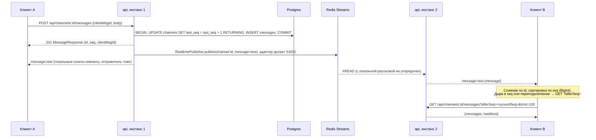

# ADR-0001: Протокол realtime

- **Статус:** Proposed
- **Дата:** 2026-11-19
- **Участники:** лид; решения приняты в тикетах фазы 2 UL-123…UL-133 и собраны здесь
- **Тикет:** UL-134
- **Связанные ADR:** [ADR-0003 «Модель данных»](0003-data-model.md) (`seq`, `UNIQUE (author_id, client_msg_id)`), ADR-0002 «Модель прав» (UL-136) — кто какие каналы видит.

## Контекст

ТЗ требует зафиксировать протокол realtime до начала основной разработки, а ROADMAP делает этот ADR третьим критерием выхода из фазы 2. С фазы 5 (начиная с UL-183 и UL-184) чат пишут несколько человек параллельно, и все они должны одинаково нумеровать, повторять и догружать сообщения.

Этот документ описывает **то, что уже работает в прототипе** на `main` (`cb5fe1c`) и проверяется в CI, а не план. Каждое решение ссылается на тест. Источники: `.planning/research/STACK.md` §0 (решения 4 и 5), §4.1, §4.3, §4.4, §4.6; итоговые комментарии тикетов UL-123…UL-133; схемы в [`packages/contracts`](../../packages/contracts/src).

Итоговое доказательство — тест выхода фазы 2 [`phase2-exit.int-spec.ts`](../../apps/api/test/integration/phase2-exit.int-spec.ts) (UL-133): A на инстансе 1, B на инстансе 2, связь B рвётся, A шлёт 5 сообщений, B возвращается и получает ровно эти 5, по `seq`, без дублей. Job `integration` прошёл 10 раз подряд: run 44480015449, попытки 1–10.

## Схема обмена

## Решения

### 1. Порядок: `seq` на канал без пропусков

- **Выбрали.** Номер выдаёт сервер в той же транзакции, что и вставку: `UPDATE channels SET last_seq = last_seq + 1 … RETURNING last_seq`, затем `INSERT` с этим `seq` ([`messages.repository.ts`](../../apps/api/src/modules/messages/messages.repository.ts)). `UPDATE` блокирует строку канала, поэтому параллельные отправки встают в очередь; упавшая вставка откатывает и номер. `seq` — `BigInt` в базе и десятичная строка на проводе (`MessageSeq`), клиент сравнивает как `BigInt` (ADR-0003, решение 2).
- **Почему.** Клиент, у которого есть 41 и пришло 43, сам понимает, что 42 потерян, и догружает его. Порядок не зависит от часов клиента и от порядка прихода событий.
- **Подтверждено.** `messages.int-spec.ts`: «20 parallel POSTs get seq 1..20, no gaps, no duplicates», «POST and GET to a missing channel return 404 and use no number» (UL-125, PR #9).

### 2. Идемпотентная отправка: `clientMsgId`

- **Выбрали.** Клиент создаёт `clientMsgId` (UUIDv7) один раз на сообщение, а не на попытку, и шлёт его при каждом повторе. Ключ уникален у автора: `UNIQUE (author_id, client_msg_id)`, приводится к нижнему регистру (`ClientMsgId` в [`message.ts`](../../packages/contracts/src/message.ts)).
  - Повтор — всегда `201` с сохранённым сообщением: тот же `id` и `seq`, даже если `body` другой (сохранённое каноническое).
  - Повтор не тратит `seq`. Поздний повтор находит ключ быстрым поиском ещё до транзакции. Одновременные запросы оба проходят мимо него, и решает уникальный индекс: проигравший получает `P2002`, вся его транзакция с `UPDATE channels` откатывается, а сохранённая строка читается уже вне её.
  - Тот же ключ в другом канале — `409`, это ошибка клиента, а не повтор. Несуществующий канал с новым ключом — `404` (с уже использованным ключом быстрый поиск отвечает раньше, и это `409`).
  - Идемпотентность держится в базе, поэтому повтор на другой инстанс даёт тот же ответ.
- **Почему.** Ответ на POST может потеряться (таймаут, обрыв), и клиент обязан иметь право повторить без дубля.
- **Подтверждено.** `messages.int-spec.ts`, блок «idempotent send (UL-126)»: последовательный повтор, 10 одновременных POST с одним ключом → одна строка и ровно один `created: true` (на уровне репозитория), другой автор (тоже через репозиторий: по HTTP автор пока один), другой текст, гонка в два канала (один `201`, один `409`), ключ в верхнем регистре. `phase2-exit.int-spec.ts`: «a retry on the other instance returns the same message and sends no second event» (UL-126 PR #17, UL-133 PR #26).

### 3. Отправка по REST, доставка по сокету, событие после коммита

- **Выбрали.** Сообщение отправляется только `POST /api/channels/:channelId/messages`; у сокета нет событий от клиента (`ClientToServerEvents` пуст, [`realtime.ts`](../../packages/contracts/src/realtime.ts)). Сервер шлёт `message:new { message }` — полный `MessageResponse`, тот же объект, что в ответе POST.
  - Сервис публикует через абстракцию `RealtimePublisher` ([`realtime-publisher.ts`](../../apps/api/src/core/realtime/realtime-publisher.ts)) и не знает о gateway. В api её реализует `RealtimeService` (`server.to(room).emit`).
  - Публикация — только после `COMMIT` и только при `created: true`. Откат, повтор, `404` и `409` событий не шлют.
  - Доставка — не более одного раза; `publish` никогда не бросает исключение в запрос. Потерянное событие клиент восстанавливает по дыре в `seq` (её видно, когда приходит следующее сообщение канала) или при переподключении (решение 5), поэтому outbox для живой рассылки не нужен. Предел этого: если потеряно последнее сообщение канала, получатель не увидит его до следующего сообщения или переподключения.
  - **Отправитель получает своё событие**: оно идёт всей комнате, без `except`. REST-запрос не знает сокета отправителя, а другим вкладкам того же пользователя событие нужно. Клиент сливает ответ POST и `message:new` по `id` (а ожидающую строку — по `clientMsgId`); в любом порядке получается одна строка: более поздняя копия заменяет такую же раннюю (`mergeMessages`).
- **Почему.** У REST есть коды ответа, валидация, таймауты и идемпотентный повтор; сокет — не хранилище, его доставка «не более одного раза» (STACK §0, решение 4).
- **Подтверждено.** `message-new.int-spec.ts`: «A on instance 1 sends, B on instance 2 receives message:new», «publishes nothing when the transaction rolls back after the insert», «publishes nothing for a retry with the same clientMsgId, on either instance», «publishes nothing for a channel that does not exist». `messages.service.spec.ts`: «publishes message:new to the channel room after the repository resolves». Клиент: `feed.test.ts` — «keeps one row when the POST copy is already there and the event copy arrives» и обратный порядок (UL-128 PR #20); блок «feedReducer arrival order» — ожидающая строка, ответ POST и `message:new` дают одну строку во всех порядках (UL-131 PR #24). Сервер: UL-127 PR #18.

### 4. Комнаты назначает сервер

- **Выбрали.** Комната канала — `channel:{id}` (`channelRoom()` в [`rooms.ts`](../../apps/api/src/core/realtime/rooms.ts)). Сокет входит в комнаты в Socket.IO-middleware (`server.use`), до пакета CONNECT, поэтому клиент, увидевший `connect`, уже подписан, и догрузка после `connect` не пропустит сообщение между GET и входом в комнату. Если войти не удалось, клиент получает `connect_error`, а не соединение, которое молча теряет события. Клиент никогда не называет комнату сам.
- **Почему.** Права проверяет сервер (STACK §4.1, §2.3); «join room X» от клиента — дыра в ACL.
- **Подтверждено.** `realtime.gateway.spec.ts`: «joins every channel room before the connection completes», «refuses the connection when the room join fails» (unit-тесты middleware). `message-new.int-spec.ts`: «keeps events of different channels in their own rooms»; `realtime.int-spec.ts`: «does not deliver room broadcasts to a connected client outside the room» (на debug-комнате) (UL-124 PR #10, UL-127 PR #18).

### 5. Догрузка после переподключения: `afterSeq` и `hasMore`

- **Выбрали.** `GET /api/channels/:channelId/messages?afterSeq=&limit=` → `{ messages, hasMore }` (`GetMessagesQuery`, `GetMessagesResponse`). Без `afterSeq` — последняя страница; с ним — сообщения с `seq > afterSeq` по возрастанию. `limit` от 1 до 100, по умолчанию 100. `hasMore` считается чтением одной строки сверх страницы.
  - Логика клиента — чистые функции в [`feed-sync.ts`](../../packages/contracts/src/feed-sync.ts) (`catchUp`, `mergeMessages`, `syncedSeq`, `resetFeed`, а также `applyCatchUp`). `catchUp` и `mergeMessages` вызывают и страница прототипа, и тест выхода фазы 2 — один и тот же код, а не копия.
  - `afterSeq` — **конец непрерывного ряда** `seq` в ленте (`syncedSeq`), а не максимальный `seq`.
  - Если `hasMore`, клиент не листает вперёд: загружает последнюю страницу и сбрасывает ленту на неё (`reset`), сохраняя живые сообщения новее страницы.
  - Догрузку запускает каждый `connect` (состояние соединения `connecting → syncing → connected`) и живое сообщение над дырой, если догрузка сейчас не идёт и прошлая не упала (идущая догрузка после конца сама проверит дыры ещё раз); само сообщение сразу попадает в ленту.
  - Дедуп по `id`, сортировка по `seq`. События, пришедшие через `XREAD` с другого инстанса, и локальная рассылка инстанса между собой **не упорядочены**: порядок прихода гарантирован только внутри одного источника. Клиент опирается на `seq` и дедуп, а не на порядок прихода.
- **Почему.** Сокет не хранит пропущенное (решение 6), поэтому единственный источник истины — база по REST. Максимальный `seq` как `afterSeq` навсегда спрятал бы потерю: собственный `201` с `seq` 45, пока 42–44 не пришли, иначе сдвинул бы границу за дыру.
- **Подтверждено.** `catch-up.int-spec.ts`: страницы и `hasMore` на границе лимита, «B misses 5 messages while away and gets all of them, in order, once», «B missed more than a page: hasMore resets the feed to the newest page». `feed-sync.test.ts` (contracts): «asks from below a hole, not after the greatest seq (own 201 above the hole)», «on hasMore it loads the newest page and resets, without paging forward». `phase2-exit.int-spec.ts`: «B gets exactly the 5 it missed, in seq order, without duplicates», «a message that comes both live and in the catch-up page is one row». Мутация «дедуп в `mergeMessages` выключен» роняет оба офлайн-теста (UL-130 PR #25, UL-133 PR #26).

### 6. Connection State Recovery выключен

- **Выбрали.** CSR не включаем; адаптер явно удаляет `connectionStateRecovery` из опций сервера ([`redis-streams.adapter.ts`](../../apps/api/src/core/realtime/redis-streams.adapter.ts)). После переподключения сокет получает комнаты заново из middleware (решение 4), а пропущенное — по REST (решение 5).
- **Почему.** См. «Отклонённые варианты»: CSR работает «по возможности», восстанавливает сохранённые комнаты и может переиграть приватный канал участнику, которого удалили, пока он был офлайн.
- **Подтверждено.** `redis-streams.adapter.spec.ts`: «removes explicitly requested connection state recovery without mutating caller options». `phase2-exit.int-spec.ts`: связь B рвётся RST с обеих сторон через TCP-связку ([`support/network.ts`](../../apps/api/test/integration/support/network.ts)), сервер видит `transport close`, B переподключается сам; наблюдатель на инстансе 2 получил все сообщения, отправленные за время обрыва, — значит, инстанс 2 их раздал, а B их потерял, и B получает их только догрузкой. Тест «a message that comes both live and in the catch-up page is one row» проверяет и обратное: после переподключения по сокету к B пришло только одно новое сообщение. Обрыв именно RST, а не `disconnect()`: после `disconnect()` socket.io сам не переподключается.

### 7. Несколько инстансов: Redis Streams adapter, sticky cookie, один origin

- **Выбрали.**
  - `@socket.io/redis-streams-adapter` ([`redis-streams.adapter.ts`](../../apps/api/src/core/realtime/redis-streams.adapter.ts)): событие с одного инстанса доходит до сокетов на других.
  - Две копии api (`deploy.replicas: 2`) за Traefik со **sticky cookie `io_srv`** (`loadbalancer.sticky.cookie.name=io_srv` в [`compose.yaml`](../../compose.yaml)); idle timeout Traefik 60 с — больше `pingInterval + pingTimeout` (45 с, умолчание Socket.IO; api их не меняет). Long-polling остаётся запасным транспортом, клиент `transports` не ограничивает. Клиент сначала делает `GET /api/health` (Traefik ставит cookie), потом `connect()`.
  - Web, `/api` и `/socket.io` — за одним Traefik на одном origin (UL-128): CORS, `withCredentials` и rewrites не нужны; клиент подключается без URL ([`socket.ts`](../../apps/web/src/shared/api/socket.ts)).
- **Почему.** Long-polling без привязки к инстансу даёт HTTP 400 (STACK §4.1). Cookie распределяет нагрузку ровнее, чем `hash $remote_addr` за NAT оператора, и не требует перечислять апстримы.
- **Подтверждено.** `realtime.int-spec.ts`: «delivers a ping triggered over HTTP on instance 1 to the client on instance 2», «does not broadcast between independent apps using the default Socket.IO adapter» (контроль). Sticky cookie автотеста не имеет: проверено вручную на стенде compose `--profile realtime` — UL-123 (PR #5, команды проверки в корневом README) и двумя окнами браузера на разных репликах в UL-128…UL-131 (UL-124 PR #10).

## Решение → тест

| Решение                                       | Тест                                                                                                                                                  | PR                        |
| --------------------------------------------- | ----------------------------------------------------------------------------------------------------------------------------------------------------- | ------------------------- |
| `seq` без пропусков                           | [`messages.int-spec.ts`](../../apps/api/test/integration/messages.int-spec.ts) «20 parallel POSTs…»                                                   | #9 (UL-125)               |
| `clientMsgId`: повтор → тот же `201`, `409`   | [`messages.int-spec.ts`](../../apps/api/test/integration/messages.int-spec.ts) «idempotent send (UL-126)»                                             | #17 (UL-126)              |
| Повтор на другой инстанс, без второго события | [`phase2-exit.int-spec.ts`](../../apps/api/test/integration/phase2-exit.int-spec.ts) «a retry on the other instance…»                                 | #26 (UL-133)              |
| `message:new` после коммита, не при откате    | [`message-new.int-spec.ts`](../../apps/api/test/integration/message-new.int-spec.ts)                                                                  | #18 (UL-127)              |
| Комнаты на сервере, до CONNECT                | [`realtime.gateway.spec.ts`](../../apps/api/src/modules/realtime/realtime.gateway.spec.ts), `message-new.int-spec.ts` «…in their own rooms»           | #18 (UL-127)              |
| Слияние POST и события в одну строку          | [`feed.test.ts`](../../apps/web/src/_pages/prototype/model/feed.test.ts) «feedReducer arrival order»                                                  | #24 (UL-131)              |
| `afterSeq` от `syncedSeq`, `hasMore` → сброс  | [`catch-up.int-spec.ts`](../../apps/api/test/integration/catch-up.int-spec.ts), [`feed-sync.test.ts`](../../packages/contracts/src/feed-sync.test.ts) | #25 (UL-130)              |
| CSR выключен                                  | [`redis-streams.adapter.spec.ts`](../../apps/api/src/core/realtime/redis-streams.adapter.spec.ts), `phase2-exit.int-spec.ts`                          | #10 (UL-124), #26         |
| B офлайн, A шлёт 5, B получает 5 по порядку   | [`phase2-exit.int-spec.ts`](../../apps/api/test/integration/phase2-exit.int-spec.ts), CI 10/10                                                        | #26 (UL-133)              |
| Доставка между инстансами                     | [`realtime.int-spec.ts`](../../apps/api/test/integration/realtime.int-spec.ts)                                                                        | #10 (UL-124)              |
| Sticky cookie `io_srv`                        | автотеста нет; ручная проверка стенда                                                                                                                 | #5 (UL-123), #20 (UL-128) |

Интеграционные тесты запускаются `pnpm --filter @app/api test:integration` (переменные — в [README api](../../apps/api/README.md), раздел «Integration tests»); в CI это обязательный job `integration`.

## Последствия

- Фаза 5 (UL-183, UL-184 и дальше) пишет чат по этому протоколу. Расхождение кода с ADR — баг одного из двух; изменение протокола — новый ADR, а не правка этого.
- Любое новое событие сервера добавляется в `ServerToClientEvents` в `packages/contracts` и публикуется через `RealtimePublisher` после коммита. Сервисы не импортируют gateway.
- Любая новая запись, которая может повторяться, получает ключ идемпотентности в базе, а не в памяти инстанса.
- Клиент никогда не доверяет порядку прихода событий: только `seq` и дедуп по `id`.
- Ответ `GET` с `hasMore` обязателен: при rolling deploy реплика старой версии вернёт ответ без него, и клиент покажет ошибку загрузки, пока выкладка не закончится (известное ограничение UL-130).

## Отклонённые варианты

- **Включить Connection State Recovery.** Документация Socket.IO называет восстановление «best-effort» — «the recovery will not always be successful», то есть догрузка по REST нужна всё равно. CSR восстанавливает сохранённые комнаты и переигрывает пакеты, поэтому может отдать сообщения приватного канала участнику, удалённому, пока он был офлайн; чтобы авторизация работала, нужен `skipMiddlewares: false`. Вернуться — только с тестом, который доказывает, что случай удалённого участника безопасен (STACK §4.4).
- **Отправлять сообщения через сокет** (`emit` с ack). Доставка сокета — не более одного раза; ack теряется так же, как ответ, но без кодов ответа, валидации и общего пути с другими HTTP-эндпоинтами. История всё равно читается по REST. Отклонено STACK §0, решение 4.
- **`max(seq) + 1`, порядок по времени клиента или по UUIDv7.** `max + 1` даёт одинаковые номера при параллельной отправке (тест на 20 параллельных POST его ловит); время клиента и UUIDv7 не дают обнаружить пропуск.
- **Ключ идемпотентности в Redis с TTL или в памяти инстанса.** Не переживает смену инстанса и истечение TTL и не атомарен со вставкой. Уникальный индекс в той же базе решает гонку в той же транзакции.
- **На повтор отвечать `200` или `409`, если текст другой.** Клиенту нужен один ответ на любую попытку: `201` с каноническим сообщением. `409` — только для ключа из другого канала.
- **Публиковать событие внутри транзакции.** Откат оставил бы у клиентов сообщение, которого нет в базе.
- **Не слать событие отправителю** (`socket.broadcast` / `except`). REST-запрос не знает сокета, а другим вкладкам и устройствам отправителя событие нужно; дубль у отправителя убирает слияние по `id`.
- **Клиент сам входит в комнаты** («join room X»). Права проверяет сервер; клиентский вход в комнату обходит ACL.
- **`afterSeq` = максимальный `seq`.** Собственный `201` над дырой прячет пропущенные сообщения навсегда (найдено ревью UL-130).
- **Листать вперёд при `hasMore`.** Неограниченное число запросов после долгого офлайна; сброс на последнюю страницу дешевле, подсказка «перейти к последним» — UL-186.
- **Классический `@socket.io/redis-adapter`.** Теряет пакеты между инстансами при кратком разрыве Redis; последний релиз 2024-03-13 (STACK §4.1).
- **Привязка по `hash $remote_addr` или только транспорт `websocket`.** Хеш по IP неровно распределяет клиентов за NAT оператора; без long-polling хуже на закрытых сетях, а стоит он здесь ничего.
- **Разные origin для web и api с CORS.** Нужны CORS, `withCredentials` и cookie между доменами; один Traefik на одном origin проще (UL-128).
- **Outbox для живой рассылки.** Потерянное событие клиент восстанавливает сам: по дыре в `seq`, когда приходит следующее сообщение канала, или при переподключении. Последнее сообщение канала, потерянное при рассылке, поэтому остаётся невидимым до следующего сообщения или переподключения; для прототипа это принято. Outbox этого не исправил бы: он делает надёжной запись побочного эффекта, а не доставку в сокет. Если фазе 5 этот случай окажется неприемлем, нужен отдельный механизм восстановления (новый ADR). Outbox нужен только для надёжных побочных эффектов (ниже).

## Границы прототипа

Это ещё **не** реализовано, и фаза 5 не должна на это опираться, пока не закроются указанные тикеты:

| Чего нет                                                                                                                                                                           | Где появится                   |
| ---------------------------------------------------------------------------------------------------------------------------------------------------------------------------------- | ------------------------------ |
| Авторизация сокета: JWT в `server.use()`, проверка Origin. Сейчас любой подключившийся входит во все каналы (`channelIdsForSocket` — все каналы), автор один — `DEFAULT_AUTHOR_ID` | фаза 3 (STACK §4.6)            |
| Комнаты по `channel_members`; удаление из канала: `socketsLeave` по всему кластеру и событие `channel:removed`                                                                     | фаза 3 (STACK §4.6), ADR-0002  |
| Outbox для надёжных побочных эффектов (упоминания, индексация, автоматизации задач)                                                                                                | фаза 7 (UL-55)                 |
| `RealtimePublisher` для worker'а (ретрансляция через Redis `rt:relay`)                                                                                                             | фаза 7 (STACK §4.2)            |
| Неотправленные сообщения в IndexedDB: сейчас они живут только в памяти вкладки и теряются при перезагрузке                                                                         | фаза 5 (UL-193)                |
| Догрузка для нескольких каналов (runner на канал), подсказка «перейти к последним» при `hasMore`                                                                                   | фаза 5 (UL-183, UL-186)        |
| Автоповтор догрузки по таймеру: после неудачной догрузки дыра ждёт Retry или следующего переподключения                                                                            | фаза 5                         |
| Переподключение после того, как сервер выкинул сокет (`io server disconnect`): socket.io его не повторяет                                                                          | фаза 3 (вместе с авторизацией) |
| Ветки (`thread_seq` без `seq` канала), правка и удаление сообщений как события                                                                                                     | фаза 6                         |
| Флаги cookie `io_srv` (`Secure`, `HttpOnly`, `SameSite`) на сервере                                                                                                                | фаза 4                         |

## Отложено / открытые вопросы

| Что                                                                                                         | Почему отложено                                     | Где вернёмся |
| ----------------------------------------------------------------------------------------------------------- | --------------------------------------------------- | ------------ |
| Совместимость `@socket.io/redis-emitter` с Streams adapter                                                  | Не проверена; выбран собственный relay (STACK §4.2) | фаза 7       |
| Ограничение Docker-провайдера Traefik по проекту compose (два локальных стенда видят контейнеры друг друга) | Касается только локальных стендов; решение за лидом | фаза 4 / лид |
| Пятое состояние соединения `reconnecting` и ручное переподключение                                          | В прототипе не нужно                                | UL-184       |
