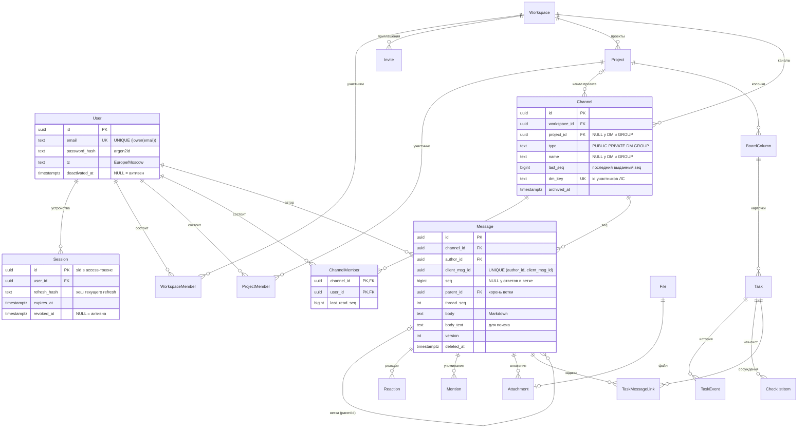

# ADR-0003: Модель данных

- **Статус:** Accepted
- **Дата:** 2026-11-16 (принят 2026-11-18)
- **Участники:** лид (автор черновика схемы), Денис (`dolgovdv`, BE-подлид, ревью 2026-11-14)
- **Тикет:** UL-212
- **Связанные ADR:** ADR-0001 «Протокол realtime» (UL-134), ADR-0002 «Модель прав» (UL-136) — роли и матрица действий живут там, здесь только то, как они хранятся.

## Контекст

На созвоне 2026-11-13 (старт фазы 2) договорились спроектировать базу целиком, а не по одной таблице на тикет. Схему дороже всего переделывать потом: таблицу с данными пользователей нельзя переписать, как компонент, нужны миграция, перенос данных и правка всех запросов. Если каждый автор тикета придумает свои ключи, имена и правила удаления, схема разъедется.

Лид собрал черновик схемы (около 40 таблиц) из эскиза `.planning/research/STACK.md` §5 и тикетов фаз 2–15; в Docs трекера он лежит как `product/db-schema`. Денис провёл ревью 2026-11-14 и ответил на 10 вопросов черновика. Этот ADR фиксирует итог: общие соглашения, решения по вопросам, ER-диаграмму ядра и то, что пока не решено.

Таблицы появляются в `apps/api/prisma/schema/` по мере тикетов, а не все сразу. Первыми по этому ADR заводятся таблицы фазы 3 (UL-139 — пользователь, UL-141 — сессии, UL-143 — пространства) и фазы 5 (UL-178 — каналы, UL-183 — сообщения). Прототип фазы 2 (UL-125, PR #9) уже реализует `channels` и `messages` по решениям 1–3.

База: Postgres 18 + pgvector, Prisma 7 (`prisma-client`, `@prisma/adapter-pg`). Prisma и SQL — только в `*.repository.ts` (пресет `nest()`).

## Общие соглашения

| Что                      | Решение                                                                                                                                                                                                                                     | Почему                                                                                                                        |
| ------------------------ | ------------------------------------------------------------------------------------------------------------------------------------------------------------------------------------------------------------------------------------------- | ----------------------------------------------------------------------------------------------------------------------------- |
| Первичные ключи          | `uuid`, значение `uuidv7()` (встроен в Postgres 18)                                                                                                                                                                                         | Упорядочены по времени — индекс не фрагментируется; не угадываются, в отличие от `serial`; клиент может сгенерировать id сам. |
| Время                    | `timestamptz`, всегда UTC                                                                                                                                                                                                                   | Пользователи в разных часовых поясах; пояс пользователя — поле `User.tz`, а не тип колонки.                                   |
| Имена                    | В Prisma `camelCase`, в базе `snake_case` через `@@map` / `@map`, таблицы во множественном числе (`channels`, `messages` — как в прототипе и в SQL черновика)                                                                               | SQL в миграциях и raw-запросах читается без кавычек.                                                                          |
| Большие счётчики         | `seq`, `lastSeq`, `lastReadSeq` — `BigInt` в базе, в API — **строка** (десятичная)                                                                                                                                                          | Prisma `BigInt` не сериализуется в JSON; строка не теряет точность на клиенте.                                                |
| Мягкое удаление          | `deletedAt` / `archivedAt` / `revokedAt` у сообщений, каналов, проектов, приглашений, сессий. Удалённое сообщение остаётся строкой: `body` / `bodyText` и связи очищаются, `seq` сохраняется                                                | Иначе в `seq` появляется дыра, и все клиенты считают, что пропустили сообщение. История нужна для аудита.                     |
| Жёсткое удаление         | Только связи: реакции, закрепы, избранное, участники                                                                                                                                                                                        | У связи нет истории, повторная вставка ничего не ломает.                                                                      |
| Внешние ключи            | Настоящие FK. `ON DELETE CASCADE` — только у дочерних связей (участник канала, реакция и т. п.); у остальных каскада нет (в прототипе — `RESTRICT`, умолчание Prisma)                                                                       | Целостность обеспечивает база, а не код; случайное удаление канала не уносит сообщения.                                       |
| Удаление пользователя    | Не удаляем, а анонимизируем: почта → хеш или заглушка, `deactivatedAt`, FK остаются                                                                                                                                                         | Сообщения и история сохраняют автора.                                                                                         |
| Оптимистичная блокировка | `version Int` у сущностей, которые правят параллельно (сообщение, задача). Обновление — `WHERE version = $v`, при конфликте 409                                                                                                             | Правка сообщения и перенос карточки на канбане.                                                                               |
| Права                    | Роли — enum в базе (`WsRole`, `ProjectRole`, `ChannelRole`), таблица «роль → права» — в `AccessService` (решение по RBAC-таблицам ниже); проверки — только `can(user, 'permission', scope)`, никогда сравнением ролей. Матрица — в ADR-0002 | Проверяем права, а не роли: новая роль — строка в enum и в таблице прав.                                                      |
| Эфемерное                | Онлайн-статус, «печатает…», лимиты, попытки входа, отозванные `sid` — в Redis, не в базе                                                                                                                                                    | Живёт секунды или минуты, база не должна это хранить.                                                                         |
| Файлы                    | В базе только метаданные, сами файлы — в S3 (SeaweedFS)                                                                                                                                                                                     | —                                                                                                                             |

### Что живёт только в raw SQL

Prisma этого не выражает. Делается raw SQL в файле миграции, в схеме колонка помечается `Unsupported(...)`, а индекс — комментарием рядом с моделью:

- `UNIQUE (lower(email))` на `users`;
- частичный `UNIQUE (channel_id, seq) WHERE seq IS NOT NULL` на `messages` (ответы в ветке без `seq`);
- частичный `UNIQUE (workspace_id, lower(name)) WHERE type IN ('PUBLIC', 'PRIVATE')` на `channels` — если решение 7 подтвердят;
- `tsvector` (`GENERATED … STORED`) + GIN и GIN по `pg_trgm` на `body_text`;
- `vector(N)` + HNSW на `ai_chunks`;
- `CHECK` «заполнен ровно один владелец» на `attachments`;
- частичный индекс `WHERE processed_at IS NULL` на `outbox`;
- `COLLATE "C"` у `position` (канбан).

## Решения

| №   | Вопрос                                                | Решение                                                                                                                                                                                                         | Почему (одна строка)                                                                                                                                            | Статус                                       |
| --- | ----------------------------------------------------- | --------------------------------------------------------------------------------------------------------------------------------------------------------------------------------------------------------------- | --------------------------------------------------------------------------------------------------------------------------------------------------------------- | -------------------------------------------- |
| 1   | Имена таблиц и колонок                                | `snake_case` через `@@map` / `@map` для всех моделей, с первой миграции                                                                                                                                         | Raw SQL без кавычек и без ошибок `"Channel"` против `channel`.                                                                                                  | ✅ принято                                   |
| 2   | Тип `seq`                                             | `BigInt` в базе, строка в API (рекомендация `Int` в UL-125 заменена)                                                                                                                                            | Запас на годы и без потери точности в JSON.                                                                                                                     | ✅ принято                                   |
| 3   | Прототип фазы 2                                       | Живёт сразу в основной схеме и дорастает миграциями фаз 3 и 5                                                                                                                                                   | Код и SQL прототипа переезжают в UL-183 почти как есть, второй раз писать не нужно.                                                                             | ✅ принято                                   |
| 4   | Уникальность email                                    | `UNIQUE (lower(email))` (raw SQL)                                                                                                                                                                               | `Ivan@x.ru` и `ivan@x.ru` — один человек.                                                                                                                       | ✅ принято                                   |
| 5   | `tokenVersion` у `User`                               | Не нужен: «выйти везде» = `UPDATE sessions SET revoked_at = now()` по пользователю, отозванные `sid` — в Redis на срок жизни access-токена (~15 мин)                                                            | Таблица сессий (UL-141) уже даёт отзыв одной и всех сессий; второй механизм лишний.                                                                             | ✅ принято (Денис, ревью PR #14, 2026-11-17) |
| 6   | Гостевой доступ                                       | Не делаем сейчас. Роль «Гость» позже — строка в enum и в таблице прав                                                                                                                                           | В ТЗ не требуется; проверки через `can()` позволяют добавить роль без переделок.                                                                                | ✅ принято                                   |
| 7   | Уникальность имени канала                             | Как в Slack: имя уникально среди `PUBLIC` и `PRIVATE` каналов пространства, **включая архивные** (`UNIQUE (workspace_id, lower(name)) WHERE type IN ('PUBLIC','PRIVATE')`); у `DM` / `GROUP` имени нет          | Разархивирование никогда не упирается в конфликт имён.                                                                                                          | ✅ принято (Денис, ревью PR #14, 2026-11-17) |
| 8   | Удаление аккаунта                                     | Анонимизация: почта → хеш или заглушка, `deactivatedAt`, FK остаются                                                                                                                                            | Сообщения и история сохраняют автора, каскад не уносит переписку.                                                                                               | ✅ принято                                   |
| 9   | `replyUserIds uuid[]` у сообщения                     | Убрать. Участники ветки — запросом по `parentId`                                                                                                                                                                | Денормализацию массива нужно поддерживать при каждом ответе и удалении; запрос по индексу `(parentId, threadSeq)` дешёв.                                        | ✅ принято                                   |
| 10  | Партиционирование `messages`                          | Не сейчас. Вернуться после нагрузочного теста длинного канала UL-109                                                                                                                                            | Проектировать под нагрузку, которой ещё нет, — ошибка; данных для выбора ключа партиции пока нет.                                                               | ✅ принято                                   |
| —   | Вынести `body` / `bodyText` в `MessageContent`        | Не выносим: тело остаётся в `messages`, формат — Markdown + `bodyText` (STACK §4.9). Вернуться, если UL-109 покажет проблему                                                                                    | Поиск идёт по отдельному индексу, длинный текст Postgres и так хранит вне строки (TOAST), а вынос даёт join на каждой странице ленты и две вставки на отправку. | ✅ принято (Денис, ревью PR #14, 2026-11-17) |
| —   | RBAC-таблицы `Role` / `Permission` / `RolePermission` | Не заводим: роли — enum в базе + статическая таблица «роль → права» в `AccessService`, проверки только через `can()`. Матрица прав — в UL-136 (ADR-0002); перенос прав в базу позже, без переписывания проверок | Своих ролей на пространство ТЗ не требует; `can()` прячет, где лежит таблица прав.                                                                              | ✅ принято (Денис, ревью PR #14, 2026-11-17) |

### Открытые вопросы (нужно решение до начала тикета)

| №   | Вопрос                                                                                                                                                                                                                                                                                                                                                                                                                                                                                                                                                                                                                                                                         | Нужно до |
| --- | ------------------------------------------------------------------------------------------------------------------------------------------------------------------------------------------------------------------------------------------------------------------------------------------------------------------------------------------------------------------------------------------------------------------------------------------------------------------------------------------------------------------------------------------------------------------------------------------------------------------------------------------------------------------------------ | -------- |
| О-1 | **Таблица `users` и FK автора в прототипе.** Черновик схемы (§4 «Прототип») говорит: `authorId` в фазе 2 — просто `uuid` **без FK**, FK появится в фазе 3. Прототип UL-125 (PR #9, миграция `20261116041921_messages`) уже создаёт таблицу `users (id, name)` и FK `messages.author_id → users(id)`, а seed заводит тестового пользователя. Варианты: (а) оставить `users` и FK — тогда UL-139 не создаёт таблицу, а дополняет её (`ALTER`), и обязательные `email`, `password_hash` упираются в уже существующую строку seed; (б) убрать `users` и FK из PR #9, как в черновике, и добавить FK миграцией UL-139 — тогда она должна проверить, что все `author_id` существуют. | UL-139   |

Вопросы 5, 7, `MessageContent` и RBAC-таблицы закрыты в ревью этого PR (Денис, 2026-11-17): по всем четырём принят вариант лида.

## ER-диаграмма ядра

Имена сущностей — модели Prisma; таблицы в базе — их `snake_case` во множественном числе. Поля показаны только у таблиц, на которых держится порядок сообщений и непрочитанное.

## Как работает `seq`

1. В одной транзакции: `UPDATE channels SET last_seq = last_seq + 1 WHERE id = $1 RETURNING last_seq`, затем `INSERT` сообщения с этим `seq`. `UPDATE` берёт блокировку строки канала, поэтому параллельные отправки в один канал выстраиваются в очередь и номера идут без пропусков. Упавшая вставка откатывает и номер. Никогда не `max(seq) + 1` и не порядок по времени клиента или UUIDv7.
2. Повтор с тем же `clientMsgId` упирается в `UNIQUE (author_id, client_msg_id)`. Сервер возвращает уже сохранённое сообщение (канонический ответ), дубля нет. Номер не тратится только если транзакция с `UPDATE` откатывается при конфликте: при `P2002` Postgres помечает транзакцию как прерванную, и существующую строку нужно читать уже вне её (UL-126).
3. Событие `message:new` уходит только после `COMMIT` (ADR-0001).
4. Непрочитанное = `channels.last_seq − channel_members.last_read_seq`, без подсчёта строк. Отметка о прочтении монотонна: `GREATEST(last_read_seq, $seq)`.
5. Мягкое удаление очищает `body` / `bodyText`, упоминания, закрепы и фрагменты ИИ, но строка остаётся, и `seq` не рвётся.
6. Ответы в ветке получают `thread_seq` и не получают `seq` канала — поэтому уникальность `(channel_id, seq)` частичная.
7. Номер задачи (`WEB-123`) выдаётся тем же приёмом: `UPDATE projects SET task_seq = task_seq + 1 … RETURNING` в транзакции создания.

Пункт 1 реализован и проверен в прототипе: `apps/api/src/modules/messages/messages.repository.ts` и тест на 20 параллельных отправок `apps/api/test/integration/messages.int-spec.ts` (PR #9).

## Состав схемы

Каждая таблица черновика либо заводится по этому ADR в своём тикете, либо отложена ниже. Полный список полей — в черновике `product/db-schema`; тикет уточняет поля, но не меняет соглашения.

| Домен                     | Таблицы                                                                                       | Ключевые ограничения                                                                                                                          | Фаза · тикет                                   |
| ------------------------- | --------------------------------------------------------------------------------------------- | --------------------------------------------------------------------------------------------------------------------------------------------- | ---------------------------------------------- |
| Пользователи и вход       | `User`, `Session`, `EmailVerification`, `OAuthAccount`, `RecoveryCode` (+ поля TOTP у `User`) | `UNIQUE (lower(email))`, `telegramChatId` UNIQUE; `Session` INDEX `(userId, revokedAt)`; `OAuthAccount` PK `(provider, providerUserId)`       | 3 · UL-139, UL-141, UL-158, UL-160, UL-161     |
| Пространства и проекты    | `Workspace`, `WorkspaceMember`, `Invite`, `Project`, `ProjectMember`                          | `slug` UNIQUE; составные PK участников; `Invite.tokenHash` UNIQUE; `Project` UNIQUE `(workspaceId, key)`                                      | 3 · UL-143, UL-146, UL-148–150                 |
| Каналы и сообщения        | `Channel`, `ChannelMember`, `Message`                                                         | `dmKey` UNIQUE; `UNIQUE (authorId, clientMsgId)`; частичный `UNIQUE (channelId, seq)`; INDEX `(channelId, seq DESC)`, `(parentId, threadSeq)` | 2 · UL-125/126 (урезанные), 5 · UL-178, UL-183 |
| Вокруг сообщений          | `Mention`, `ThreadSubscription`, `Reaction`, `Pin`, `SavedMessage`, `ScheduledMessage`        | составные PK; `Mention` INDEX `(userId, channelId, seq)`                                                                                      | 6 · UL-49, UL-51–53, UL-201                    |
| Файлы                     | `File`, `Attachment`                                                                          | `storageKey` UNIQUE; `CHECK` ровно один владелец                                                                                              | 7 · UL-56                                      |
| Надёжные побочные эффекты | `Outbox`                                                                                      | частичный индекс `processed_at IS NULL`                                                                                                       | 7 · UL-55                                      |
| Задачи и канбан           | `BoardColumn`, `Task`, `ChecklistItem`, `TaskEvent`, `TaskMessageLink`                        | `Task` UNIQUE `(projectId, number)`; `position` — дробный ключ `COLLATE "C"`                                                                  | 8–9 · UL-61                                    |
| GitHub                    | `GithubInstallation`, `ProjectRepo`, `PullRequest`, `TaskPullRequest`, `GithubDelivery`       | `GithubDelivery.deliveryId` PK — защита от повторного вебхука                                                                                 | 10                                             |
| Уведомления               | `Notification`, `NotificationPref`, `TelegramLinkToken`, `PushSubscription`                   | `Notification` UNIQUE `(userId, dedupeKey)`                                                                                                   | 11 · UL-85, UL-87, UL-88, UL-206               |
| Стендапы и решения        | `StandupConfig`, `StandupRun`, `StandupAnswer`, `Decision`, `DecisionTask`                    | `StandupRun` UNIQUE `(configId, localDate)`; `Decision.supersedesId` UNIQUE                                                                   | 12 · UL-93, UL-95/96                           |
| ИИ                        | `AiRequest`, `AiChunk`                                                                        | `embedding vector(N)` + HNSW                                                                                                                  | 13                                             |

## Последствия

- UL-139, UL-141, UL-143, UL-178, UL-183 заводят таблицы по соглашениям этого ADR; отступление от них — правка ADR в том же PR.
- Таблицы прототипа (`channels`, `messages`) дорастают `ALTER`-миграциями. Миграция, которая добавляет обязательную колонку (`channels.workspace_id`, `messages.client_msg_id`), должна учитывать уже существующие строки seed: значение по умолчанию, заполнение или пересоздание dev-базы — явно в PR.
- Каждый контракт в `packages/contracts`, где есть `seq`, `lastSeq` или `lastReadSeq`, отдаёт строку (в прототипе — `MessageSeq`), а клиент сравнивает номера как `BigInt`, не как `Number`.
- Индексы и ограничения из raw SQL живут только в миграциях. Перед первым таким индексом проверить, что `prisma migrate dev` не предлагает их удалить при следующем изменении схемы.
- Ревью `prisma/**` — BE-подлид (CODEOWNERS); ревьюер сверяет миграцию с этим ADR.
- Для удаления аккаунта нужен отдельный путь анонимизации, а не `DELETE FROM users`; FK с `RESTRICT` это гарантируют.

## Отложено

| Что                                         | Почему отложено                                                                             | Где вернёмся                    |
| ------------------------------------------- | ------------------------------------------------------------------------------------------- | ------------------------------- |
| Партиционирование `messages`                | Нагрузки и данных для выбора ключа партиции пока нет (решение 10)                           | после нагрузочного теста UL-109 |
| `MessageContent` (тело в отдельной таблице) | Без измерений выигрыш не доказан, а join и вторая вставка — сразу                           | UL-109                          |
| Права в таблицах базы (RBAC)                | Своих ролей на пространство ТЗ не требует; `can()` позволяет перенести права позже          | UL-136 (ADR-0002)               |
| Роль «Гость»                                | В ТЗ не требуется (решение 6). «Гость» из UL-150 — человек по ссылке-приглашению, а не роль | отдельного тикета нет           |
| Таблица аудита `AuditLog`                   | UL-110 (аудит доступа) — проверка кода и негативные тесты, а не таблица                     | не нужна                        |
| Выдача `threadSeq` у ответов в ветке        | В черновике механизм не описан; ветки — фаза 6                                              | тикет веток фазы 6              |

## Отклонённые варианты

- **`MessageContent` (вариант Дениса):** `body Json` (блоки в стиле Slack) и `bodyText` в отдельной таблице `message_contents` с `ON DELETE CASCADE`. Отклонён: поиск идёт по своему индексу (`tsvector` + GIN, `pg_trgm`), а не по строке `messages`; длинный текст Postgres и так выносит из строки (TOAST); каждая страница ленты получает join, каждая отправка — две вставки. Формат тела — Markdown (STACK §4.9), JSON-блоки не нужны. Вернёмся, если UL-109 покажет проблему.
- **RBAC-таблицы (вариант Дениса):** `roles` (с `workspace_id`, `NULL` у системных ролей), `permissions`, `role_permissions`, а у `WorkspaceMember` — `roleId` вместо enum. Отклонён: свои роли на пространство не требуются, а `can()` прячет, где лежит таблица прав, поэтому перенос в базу позже не потребует переписывать проверки. Если вариант вернётся: `@@unique([workspaceId, name])` с `NULL` не защищает системные роли от дублей — нужен `UNIQUE NULLS NOT DISTINCT` (raw SQL). Матрица прав — в UL-136.
- **Отдельная таблица для участников ветки** (второй вариант Дениса к вопросу 9) и массив `replyUserIds` из STACK §5 — не нужны: участники ветки считаются запросом по `parentId`.
- **Denylist refresh-токенов + `token_version`** (STACK §2.1) — заменены таблицей сессий (решение лида от 2026-11-12, UL-141); `tokenVersion` — см. решение 5.
- **Отдельная схема для прототипа фазы 2 с выбросом в фазе 5** — отклонено решением 3.

## Расхождения, найденные при подготовке

Сверены черновик схемы (v2), STACK §2.1–2.3, §4.3–4.5, §5, тикеты UL-125, UL-126, UL-139, UL-141, UL-143, UL-178, UL-183 и код PR #9 (`origin/feature/UL-125`, `9a12a9f`). Здесь только то, что ещё не учтено в решениях выше.

| №    | Где                                    | Расхождение                                                                                                                                                                                                                                                                                                                                                          | Что сделать                                                                                                            |
| ---- | -------------------------------------- | -------------------------------------------------------------------------------------------------------------------------------------------------------------------------------------------------------------------------------------------------------------------------------------------------------------------------------------------------------------------- | ---------------------------------------------------------------------------------------------------------------------- |
| Р-1  | Черновик §4 ↔ PR #9                    | Черновик: `authorId` без FK до фазы 3. PR #9: таблица `users` и FK `messages.author_id → users`.                                                                                                                                                                                                                                                                     | Открытый вопрос О-1, до UL-139.                                                                                        |
| Р-2  | Соглашения / STACK §5 / UL-139 ↔ PR #9 | Соглашение и UL-139 («id генерирует база, а не код»): `DEFAULT uuidv7()` в базе (`dbgenerated("uuidv7()")`). PR #9: `@default(uuid(7))` — id генерирует Prisma Client, в миграции у `id` нет `DEFAULT`; вставка raw SQL без id упадёт.                                                                                                                               | Выбрать один способ и записать в соглашения (лид / Денис).                                                             |
| Р-3  | Черновик §4 ↔ PR #9 ↔ UL-125           | Черновик §4: в прототипе `clientMsgId`, `bodyText` и частичный `UNIQUE (channelId, seq) WHERE seq IS NOT NULL`. PR #9 и шаг 1 UL-125: полный `UNIQUE (channel_id, seq)`, `seq NOT NULL`, нет `client_msg_id` и `body_text`. `clientMsgId` по плану добавляет UL-126; кто добавляет `bodyText` и переводит `seq` в nullable с частичным индексом, нигде не назначено. | Поправить черновик §4 под PR #9 и назначить `bodyText` и частичный индекс тикету (UL-183 или веткам фазы 6).           |
| Р-4  | Модель `Channel` ↔ PR #9               | PR #9: `channels.name NOT NULL`. Полная модель: `name?` — у `DM` / `GROUP` имени нет.                                                                                                                                                                                                                                                                                | Миграция, которая вводит `DM` / `GROUP`, снимает `NOT NULL` (и добавляет частичный индекс, если решение 7 подтвердят). |
| Р-5  | UL-178, UL-183, UL-139 ↔ решение 3     | UL-178 и UL-183 пишут «таблица `Channel` / `Message`, миграция», UL-139 — «таблица `User`», как будто таблицы создаются с нуля. По решению 3 (и при варианте (а) О-1) это `ALTER` существующих таблиц прототипа с данными seed.                                                                                                                                      | Уточнить формулировки тикетов (лид).                                                                                   |
| Р-6  | UL-183 ↔ UL-126                        | UL-183 снова перечисляет «уникальность `clientMsgId` у автора; миграция», хотя её вводит UL-126 в фазе 2.                                                                                                                                                                                                                                                            | Оставить в UL-183 только перенос и проверку, не повторную миграцию.                                                    |
| Р-7  | STACK §5 ↔ решения                     | В эскизе STACK §5: `User.email @unique` (с учётом регистра), `tokenVersion`, `replyUserIds`, нет `deactivatedAt`, `emailVerifiedAt`, `Session`; `@default(dbgenerated("uuidv7()"))` только у `User` и `Message`. STACK §2.1 описывает denylist и `token_version`.                                                                                                    | STACK §5 — эскиз («expect W1–W2 ADR changes»); при следующей правке `.planning/` (только лид) сослаться на этот ADR.   |
| Р-8  | UL-141 ↔ черновик                      | UL-141 перечисляет поля `Session` без срока жизни; черновик добавляет `expiresAt`.                                                                                                                                                                                                                                                                                   | Мелочь: взять поля из черновика.                                                                                       |
| Р-9  | PR #9 ↔ соглашения                     | PR #9 задаёт точность времени `Timestamptz(3)` (по умолчанию Prisma — миллисекунды); соглашение говорит просто `timestamptz`.                                                                                                                                                                                                                                        | Решить, фиксируем ли `(3)` для всех таблиц, и дописать в соглашения.                                                   |
| Р-10 | UL-136 / UL-134 ↔ `docs/adr/`          | UL-136 и UL-134 ссылаются на формат ADR `docs/adr/0000` из UL-3; UL-3 закрыт, но шаблона в репозитории нет. ADR-0002 (UL-136) ещё не начат, а этот ADR опирается на его enum ролей и `ChannelRole` (значения `ChannelRole` нигде не перечислены).                                                                                                                    | Шаблон и правило нумерации — в `docs/adr/README.md` (этот PR); значения `ChannelRole` — в ADR-0002.                    |
